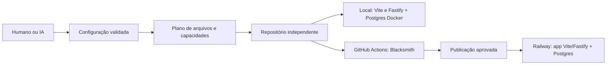

# DESIGN: base independente de projetos Renova

Spec: [requirements.md](requirements.md). Contexto: [context.md](context.md).
Incremento local entregue: autenticação opcional autorizada após confirmar o CI da main
`e085504`. A instalação deste incremento atende clones novos antes do ambiente
local; T-030 (adição a produto existente) continua separada. A receita fixa vive em
`templates/modules/auth/files`, fora dos workspaces: somente o perfil escolhido
recebe dependências, tabelas e páginas de auth. Não há carregador de plugins.
Email local usa Mailpit isolado por projeto; o transporte Resend HTTPS está
implementado para o Railway, com entrega e jornada validadas nos pilotos isolados. Os guias de [acesso](../../process/authentication.md) e
[Railway](../../process/railway.md) concentram a operação para humanos e IA.

Estado: plano aprovado; T-000–T-019 e T-031 implementados e validados localmente.
As seções descrevem a arquitetura implementada e identificam evoluções futuras. Configuração guiada e
diagnóstico já estão entregues; T-015–T-019 implementam a autenticação opcional local
e passaram pela [validação local](auth-validation.md). Docker, publicação Railway
e Resend estão implementados; evidências e pendências remotas ficam em
[railway-validation.md](railway-validation.md). T-030 continua futuro.
A base local já tem Vite/Fastify/Postgres/UI; o exemplo anterior foi retirado
por autorização do usuário.

No incremento local, `packages/db-types` tem tipos explícitos confrontados com o
schema real nos testes; codegen não foi introduzido. O estado do banco fica em
`.renova/db-state.json` e os helpers em `scripts/db/`. Configuração TypeScript
compartilhada continua no `tsconfig.base.json`, sem novo pacote apenas para isso.

## Architecture Overview

Template GitHub com base executável e uma receita fixa de autenticação.
O configurador materializa código no projeto; não instala um sistema de plugins
dinâmicos na aplicação. Cada projeto funciona sem serviço central Renova.
As alternativas e suas razões estão na [pesquisa](research.md).



## Fronteira de composição

| Camada | Sempre presente | Selecionável na v1 |
| --- | --- | --- |
| Aplicação | Vite/React, Fastify/tRPC, Postgres/Kysely, contratos TypeScript | Perfil sem login ou com login |
| Visual | `packages/ui`, fontes, tokens, catálogo e shell | Nome do projeto; identidade Renova permanece |
| Segurança | Validação, autorização declarada, limites, logs sanitizados, proteção de configuração | Nenhuma opção para desligar o núcleo |
| Desenvolvimento | Setup, doctor, testes, harness e instruções no clone | Execução guiada ou manifesto/JSON para IA |
| Entrega | Arquivos de CI e contratos de container | Conectar GitHub/Railway quando necessário |
| Executor CI | Blacksmith em organização GitHub autorizada | Habilitação por repositório; sem fallback automático |
| Identidade | Nenhuma identidade compartilhada entre projetos | Módulo auth completo; email é dependência desse módulo |

Sem login é um perfil suportado. Não existe `AUTH_ENABLED=false` que converte
handlers protegidos em públicos. A política de acesso é registrada junto à rota.

## Estrutura local e publicação remota

```text
apps/frontend/                  Vite, rotas, providers e cliente tRPC
apps/backend/                   Fastify, env, políticas e módulos de aplicação
packages/ui/                    componentes, fontes e tokens Renova
packages/dbmigrator/             runner e migrations próprias
packages/db-types/               tipos do schema
tsconfig.base.json              configuração TypeScript compartilhada
packages/auth/                  somente no perfil com login
templates/modules/auth/files/   arquivos da receita, fora dos workspaces runtime
templates/modules/auth/recipe.json  caminhos e hashes da base substituível
scripts/project/                configuração, planos, geração e diagnóstico
scripts/auth/invite.mjs         somente com login; liberação local pelo responsável
scripts/deploy/                 setup, plano, aplicação e verificação Railway
renova.project.json             identidade e capacidades, sem segredos
.renova/                       estado local ignorado de projeto, setup e banco
docker-compose.yml             Postgres; caixa de email apenas com auth
Dockerfile                       build Vite/Fastify e runner de migration
.railway/railway.ts               IaC nativo, somente serviço app
```

Node 24 e pnpm com versão exata no `packageManager`. Manter workspaces e scripts
simples; Turbo só entra se a execução dos workspaces justificar, sem ser requisito
de produto. O contrato tRPC continua exportado como tipos do backend; frontend
não importa implementação, conexão de DB ou segredos do servidor.

Bootstrap do configurador usa módulos nativos de Node antes de instalar dependências.
Receitas ficam fora dos workspaces runtime. Cada perfil usa um lockfile gerado e
validado na release do template; setup não resolve versões `latest` por conta própria.
Atualizações de dependências recompõem e validam os dois perfis.

## Experiência de criação

1. Criar repositório pelo template ou obter uma cópia local sem publicar.
2. `pnpm run setup` pede o nome e, em clone novo, oferece sem login (padrão) ou
   contas liberadas pelo responsável. A repetição preserva o perfil escolhido;
   não pergunta sobre biblioteca, ORM, email externo ou Railway.
3. Mostrar resumo de arquivos/capacidades. Aplicar somente após aceite local.
4. Instalar o lockfile do perfil, preparar DB e aplicar migrations; com login,
   compilar `packages/auth` e iniciar a caixa Mailpit local.
5. `pnpm dev` mostra URL local e estado dos serviços. `pnpm run doctor` explica falhas.
6. Com login, o responsável libera a conta pelo comando `auth:invite`; a pessoa
   abre o link capturado no Mailpit e define sua própria senha.
7. Para publicar, seguir o [guia Railway](../../process/railway.md): criar um
   serviço `app` e Postgres privado, executar `deploy:setup` com IDs explícitos,
   preparar o plano, aplicá-lo após CI aprovado e verificar a origem publicada.

GitHub/Railway ausentes não bloqueiam local. Ferramenta de tarefas é opcional
também para PRs; objetivo e critérios ficam no pedido/spec local. Instalação de Docker/Node
é pré-requisito explicado; setup não promete instalar software de sistema com
privilégios. macOS, Linux e WSL2 são a matriz inicial. Um devcontainer pode ser
avaliado depois do piloto se os pré-requisitos forem o principal obstáculo.

Setup, doctor, a receita de login local e os comandos de publicação estão
implementados. `module:add` continua futuro em T-030. Use `run`: `setup` e `doctor`
também são comandos internos do pnpm.

| Comando | Efeito | Não faz |
| --- | --- | --- |
| `pnpm run setup -- --config renova.project.json --plan` | Valida e apresenta plano local | Não escreve arquivos nem inicia containers |
| `pnpm run setup -- --config caminho.json --yes` | Aplica configuração local já fornecida | Não concede publicação, custo ou acesso remoto |
| `pnpm run doctor -- --json` | Diagnóstico seguro para IA/CI | Não altera configuração nem imprime ambiente completo |
| `pnpm auth:invite -- email@exemplo.com "Nome da pessoa"` | Libera conta e envia link à caixa local no perfil com login | Não cria senha padrão nem envia email externo |
| `pnpm test:profiles` | Materializa os dois perfis em cópias descartáveis e executa seus gates | Não modifica o ambiente local existente |
| Futuro: `pnpm module:add -- auth --plan` | Planejará evolução de projeto existente | Não muda automaticamente ownership ou permissões |
| `pnpm deploy:setup --project PROJETO_UUID --environment AMBIENTE_UUID --service APP_UUID --database POSTGRES_UUID --origin https://seu-app.up.railway.app` | Prepara identidade e credenciais próprias no banco novo e configura variáveis do app | Não cria recursos Railway, copia dados locais nem publica código |
| `pnpm deploy:prepare --project PROJETO_UUID --environment AMBIENTE_UUID --service APP_UUID` | Valida destino e fixa o plano IaC nativo ao commit limpo | Não altera configuração remota nem publica |
| `pnpm deploy:apply --confirm-project PROJETO_UUID` | Revalida plano/destino/CI e envia o código do mesmo commit | Não usa destino implícito nem comprova saúde do deployment |
| `pnpm deploy:verify --origin https://seu-app.up.railway.app` | Verifica HTTP, health/readiness, estáticos e mesma origem | Não comprova entrega de email, restauração ou aceite humano |

No setup local sem TTY, `--config` é obrigatório, inclusive para `--plan`; aplicar exige `--yes`. Ausência de escolhas obrigatórias termina com código 2; não aguarda
entrada para sempre. JSON tem versão de schema, `status` e `nextActions`; doctor contém `checks`, setup contém `steps` e plano contém `files`; segredos nunca integram sua saída. Não interpretar uma string do
manifesto como comando shell: argumentos estruturados e catálogo local confiável.

## Modelo de configuração e estado

Formato declarativo lido pelo configurador. Parta do `renova.project.json` do clone e preserve sua origem:

```json
{
  "schemaVersion": 1,
  "project": { "slug": "meu-projeto", "displayName": "Meu projeto" },
  "profile": "public",
  "capabilities": [],
  "initialTarget": "local",
  "origin": { "templateVersion": "0.1.0-dev", "sourceRevision": "d0c2db9", "uiVersion": "0.1.0-dev" }
}
```

`profile` aceita `public` ou `authenticated`. O segundo implica capacidade
`auth`; inconsistência é erro, não uma configuração parcialmente funcional.
Slug: 3–48 caracteres ASCII, `[a-z][a-z0-9]*(?:-[a-z0-9]+)*`, sem nomes reservados
de sistema. Nome de exibição: 1–80 caracteres, tratado como texto, nunca HTML.
Paths de saída são resolvidos sob a raiz autorizada e symlinks de escape recusados.

`initialTarget` não determina autorização runtime. Configuração por ambiente fica
em env validado. IDs reais da instalação Railway são registrados após vinculação;
não entram como defaults no template de origem. Tokens e senhas ficam em `.env`
local ignorado ou no cofre do provedor. `deploy:setup` também preserva credenciais
próprias em `.renova/railway-credentials.json`, ignorado e com permissão 0600, para
reexecução sem rotação. Nenhum `.env` criptografado do Renova atual
é copiado. O manifesto não contém credenciais nem estado pessoal.

Estado de setup: `planned → applying → ready` ou `failed`. Cada etapa registra
seu resultado verificável. Reexecução confere recurso e versão antes de reutilizar.
Geração trabalha em diretório temporário, valida resultado e aplica diff; conflito
em arquivo alterado pelo usuário falha antes de substituir. Falha de DB preserva
volume; não existe limpeza automática do banco como compensação.

O clone contém os workspaces públicos completos. Nesse perfil, o gerador altera
somente a identidade em `renova.project.json` e seu registro de hash em
`.renova/project-state.json`; código e lockfile permanecem intactos.

A escolha `authenticated` em clone novo materializa os arquivos de
`templates/modules/auth/files/`, incluindo o lockfile já resolvido. O mapa
`recipe.json` exige o hash original ou o conteúdo exato da receita; customização,
link inseguro ou plano desatualizado interrompe a aplicação sem sobrescrever.
A instalação só começa antes de existir `.env` ou `.renova/db-state.json`.
Editar o próprio manifesto antes do primeiro setup também é suportado.

Um registro local de instalação iniciada impede retorno ao perfil público após
interrupção. Os arquivos de runtime são publicados antes do manifesto;
`packages/auth/package.json` é o último arquivo da receita publicado. Assim, um
novo clone de produto autenticado reconhece a composição já instalada sem depender
do estado ignorado em `.renova`, preservando personalizações na repetição.
Remoção automática de login e adição a produto já preparado continuam recusadas.
Após criar ambiente local, o slug fica fixo para preservar a identidade do banco.
O configurador local aceita somente `initialTarget: local`; a publicação Railway
usa comandos separados e não muda esse contrato.

A preparação local registra passos sanitizados em `.renova/setup-state.json`, confere
pré-requisitos, instala o lockfile, prepara credenciais, sobe Postgres e migra o schema.
Com login, também prepara segredo próprio, portas SMTP/UI distintas e Mailpit em
loopback; o perfil público não recebe essas chaves, dependências ou serviço.
A repetição verifica todos os passos idempotentes; um checkpoint verde não dispensa
conferir o recurso atual. Credenciais em publicação interrompida ficam sob `.renova`
ignorada e permissão 0600, com journal e hash; só o estágio reconhecido pode retomar.

Doctor é somente leitura e valida o DB vinculado, sem compilar ou instalar nada.
Seu código 0 significa ambiente local pronto; ambos os serviços desligados com
portas livres são válidos, com `pnpm dev` como próxima ação. Serviços ativos exigem
health/readiness, proxy e HTML válidos; execução parcial ou portas de outro serviço
retornam código 1. Configuração inválida retorna 2. CI/provedor são explicitamente
não verificados por esse diagnóstico local. Com login, doctor também confere
Mailpit do mesmo projeto, saúde e portas em loopback; não envia nem lê mensagens.

A página `/` é reservada ao produto (`HomePage.tsx`), inicialmente com um guia
substituível de primeiros passos sem consulta à API de negócio. No perfil com
login, `AuthGate` valida a sessão antes de mostrar esse guia; `/minha-area` contém
a demonstração privada de registros por proprietário. O guia orienta a consulta
à referência, a descrição da ideia para a IA e a substituição da HomePage pelo produto; comandos de ambiente ficam em ajuda recolhida. `/referência`, com alias `/referencia`, carrega os exemplos sob demanda e
usa a logo oficial local com origem registrada. Features novas pertencem às páginas
do produto, reutilizando componentes da referência e de `@renova/ui`.

## Components

| Componente | Interface planejada | Dependências / responsabilidade |
| --- | --- | --- |
| Configurador | `parseProjectConfig(input)` | Schema fechado e compatibilidade; sem I/O |
| Planejador | `planProject(root, config)` | Lista arquivos, conflitos e passos; não executa |
| Aplicador local | `applyProject(plan)` | Verifica hashes, aplica identidade e preserva WIP |
| Setup | `runSetup(root, config)` | Etapas retomáveis, conexão local, migrations |
| Doctor | `diagnose(target)` | Estado sanitizado, causa e ação; não corrige escondido |
| Política API | `registerOperation({access, handler})` | Política obrigatória e default deny |
| Auth opcional | `getSession(request)`, handler da biblioteca | Identidade sem regras BPO/empresa |
| Deploy | `setupRailway`, `prepareRelease`, `applyRelease` e CLI `deploy:verify` | Destino explícito, plano IaC nativo, hash/validade e verificação separada |

Não criar abstração para vários provedores de auth ou deploy na primeira versão.
Uma fronteira pequena atende o caso real; nova implementação exige demanda e teste.

## Perfis e dados

### Sem login

Página inicial, catálogo e exemplo de leitura no Postgres de registros sintéticos
declarados públicos. Sem mutation de negócio, conta, sessão ou fixture privada.
Mesmo comportamento local e cloud. Pessoas podem desenvolver escrita pública,
mas isso é uma nova feature com limites, retenção e revisão específicos.

### Com login

`packages/auth` integra Better Auth **1.7.11**, com email/senha e cadastro público
fechado. O responsável executa `pnpm auth:invite -- email@exemplo.com "Nome da pessoa"`
localmente; a conta permanece pendente até a pessoa usar o link único e definir a
senha. A receita oferece entrada, ativação, saída e recuperação sem senha universal,
seed admin remoto, painel de gestão ou mensagens de produto.

Mailpit **1.31.6** captura os emails locais no Docker deste projeto, com SMTP e
interface acessíveis somente em loopback e sem relay externo. No Railway, o
perfil autenticado exige `RESEND_API_KEY`, `AUTH_EMAIL_FROM`, segredo próprio e
origem HTTPS canônica. O transporte usa Resend por HTTPS, com timeout, sem
redirecionamento nem repetição silenciosa. O convite remoto confere IDs do destino
e identidade real do banco; empacotamento e jornada remota passaram no piloto.
Falha de envio preserva a conta pendente e permite reenvio limitado pelo comando.
Recuperação mantém resposta genérica para email existente/inexistente, inclusive
em falha de envio. O comando administrativo informa falha ou aceitação do envio
sem expor tokens; aceitação pelo SMTP ou Resend não prova recebimento por uma pessoa.

Migrations próprias e revisadas criam as tabelas `auth_user`, `auth_account`,
`auth_session`, `auth_verification`, `auth_rate_limit`, `auth_account_limits` e
`owned_records(id, owner_id, title, created_at, updated_at)`. `title` tem 1–120
caracteres e listagem limitada a 100 registros. O exemplo público continua em
tabela separada, somente leitura, sem atribuir dono à primeira conta criada.

O experimento e a decisão técnica estão em [auth-spike.md](auth-spike.md).
T-015–T-019 passaram nos gates locais; evidências e limites estão em [auth-validation.md](auth-validation.md).
Se a integração falhar, registrar a decisão revisada antes de trocar a biblioteca;
não começar silenciosamente um mecanismo próprio de autenticação.

## Segurança mínima e limites do incremento local

Valores abaixo são defaults explícitos do projeto, não exigências universais OWASP.
As verificações de publicação e ambiente remoto continuam nas etapas próprias.
Não devem ser apresentados ao iniciante como opções para desativar proteção.

| Risco | Controle | Oráculo de validação |
| --- | --- | --- |
| Operação inadvertidamente pública | Política obrigatória `public`/`authenticated`; proprietário em cada consulta/mutation privada | Rota sem política recusada; usuário B não lê/edita registro de A (404) |
| Login desativado por variável | Composição gera módulo completo ou o omite; rotas privadas sem módulo impedem startup | Perfil inválido falha; nenhum fallback para visitante |
| Roubo/fixação de sessão | Sessão no servidor; cookie HttpOnly, Secure em produção, SameSite=Lax na topologia de mesma origem; sem Domain amplo | Login renova identidade; logout/recuperação invalida; token ausente no localStorage |
| Sessão ilimitada | Expiração absoluta de 8 h; tokens de ativação/recuperação 15 min e uso único | Relógio controlado e replay recusado |
| Senha fraca/abuso | Biblioteca mantida; senha 15–128 caracteres sem truncamento; login com resposta genérica | Limites de tamanho e conta inexistente; hashing validado pela biblioteca |
| CSRF/origem falsa | Recusar Origin presente e divergente em escritas; com cookie, exigir origem exata e prova CSRF. Chamada pública sem Origin continua permitida; isso não autentica clientes nem usa CORS como auth | 403 sem efeito no DB na origem maliciosa; testar tRPC e handler auth |
| XSS/exposição de front | React escapando texto, sem HTML arbitrário; CSP por ambiente testada, nosniff e Referrer-Policy | Payload vira texto; CSP permite apenas recursos previstos |
| Abuso de API | Body máximo 1 MiB, 120 req/min/IP geral; login 5 tentativas/15 min por conta e IP; 429 com Retry-After | 413/429 determinísticos; rate limit de auth persistente entre reinícios |
| Exaustão/SQL | Zod no servidor, queries parametrizadas, paginação até 100; timeout de consulta 5 s | Entrada inválida 400; DB cancela consulta; nenhuma concatenação de entrada em SQL |
| Vazamento em diagnóstico | Logs estruturados com correlationId, sem bodies/headers sensíveis; erro público 5xx genérico | Sentinelas não aparecem em logs, JSON, bundle, imagem ou artefatos |
| Segredos/defaults em produção | Env validado, segredos por projeto, URLs canônicas HTTPS, nenhuma fixture privada | Startup e prepare recusam configuração inválida |
| Uso do DB errado | Alvo local explícito; testes usam banco descartável identificado; runtime separado do migrador | Recusa ocorre antes da escrita; nenhum acesso ao banco real |
| Migration concorrente/incompatível | Lock, histórico com integridade, falha interrompe release; revisão de mudança destrutiva | Duas execuções não aplicam a mesma migration; versão modificada falha |
| Dependência vulnerável | Lockfile, atualização revisada e triagem de alertas; exceção com dono, justificativa e validade | CI detecta fixture de segredo; revisão registra risco de dependência sem supor que audit prova segurança |

Limitação inicial: backend com uma réplica. Limites gerais em memória não são
distribuídos; aumentar réplicas exige store compartilhado e nova validação. Limites
de login não podem ser contornados por reinício. Configurar confiança no proxy
para a topologia efetiva; cliente não deve escolher IP por header arbitrário.
TLS do Postgres é configurado por ambiente; nunca copiar `rejectUnauthorized:false`
sem verificar o contrato do destino. Runtime não deve operar como superusuário.

## Design system

Extrair a revisão Renova registrada na pesquisa, com licença e origem. Remover
nomes de pessoas/cargos, conteúdo BPO e variantes que dependem de CSS externo.
Fontes e tokens pertencem ao pacote; a aplicação somente consome. Galeria demonstra
componentes existentes, estados e composições. Não prometer dark mode completo.
Testar foco/teclado/390 px e fontes efetivamente carregadas; Radix não substitui
essa prova. O catálogo não mostra informações internas, tokens ou dados reais.

## Railway e CI

Uma imagem Docker executa o serviço `app`: Fastify serve o build Vite e `/api` na
mesma origem. Postgres 18 fica na rede privada, com volume próprio, no mesmo
projeto e ambiente. O desenvolvimento mantém Vite e Fastify separados. O build
usa a raiz do monorepo e inclui as dependências compartilhadas necessárias.

O responsável cria o projeto novo, Postgres e serviço vazio `app`. `deploy:setup`
exige os quatro IDs e a origem HTTPS; prepara papéis separados, permissões e
identidade do banco por SSH/stdin no Postgres. A credencial administrativa não vai
para o app. Reexecução preserva credenciais; identidade divergente ou banco ocupado
sem a identidade esperada são recusados. Variáveis são configuradas sem publicar.

`deploy:prepare` exige IDs explícitos de projeto, ambiente e serviço, valida o
vínculo e gera o plano nativo de `.railway/railway.ts`. O recorte `renova-app`
administra somente `app`; plano destrutivo é recusado. `.renova/railway` guarda o
plano e metadados com permissão 0600: SHA do commit, árvore `.railway`, destino,
hash do plano e validade de 30 minutos. A saída mostra IDs e ações sanitizadas.

`deploy:apply --confirm-project` revalida destino, hash, validade, HEAD e árvore
limpa, incluindo arquivos não ignorados. Exige sucesso do workflow `CI` mais
recente e do job `ci` para o SHA exato. Aplica o plano nativo salvo e envia
um `git archive` desse commit por `railway up`; não publica WIP nem seleciona um
digest de imagem. Configuração, upload e verificação de saúde são etapas distintas.
Autodeploy que contorne esse gate não deve ser conectado. Resultado desconhecido
exige consulta antes de repetir; divergência exige novo plano. Falha não apaga
recursos. O plano não cria nem administra o Postgres ou seu volume.

Publicação inicial usa domínio gerado Railway; domínio corporativo é etapa
adicional explícita. Nenhuma migração da infraestrutura Renova atual faz parte
do plano. Banco local nunca é copiado implicitamente. Backups e restauração em
destino descartável devem ser ensaiados antes de admitir dados reais.

Pré-deploy aplica migrations com papel próprio, lock e transação; falha impede
promoção. Não roda no build ou na inicialização da API. `/health` é liveness;
`/ready` verifica identidade, permissões e histórico de migrations com resposta
sanitizada. `deploy:verify --origin` verifica os endpoints e estáticos por HTTPS;
não declara frontend saudável como prova de fluxo autenticado ou entrega de email.
Readiness exige histórico exato: uma imagem antiga não é automaticamente compatível
com schema novo. Rollback de imagem não reverte banco; mudança destrutiva precisa plano separado.

GitHub Actions executa um job `ci` em Blacksmith
(`blacksmith-2vcpu-ubuntu-2404`). Integração é sequencial e E2E usa 1 worker;
4 vCPU ficava ocioso. Sem agregador nem job extra: o próprio `ci` é o check
de proteção e o alvo do `deploy:apply`. A habilitação exige organização GitHub e acesso do App Blacksmith
ao novo repo; clone não replica esse vínculo e repositório pessoal não é suportado
pelo serviço. `doctor` distingue local pronto de CI corporativo habilitado; acesso
não verificável fica como pendência, nunca como sucesso presumido. Nenhum fallback
silencioso para runners GitHub hospedados. Um projeto pode trabalhar localmente
sem essa habilitação. Admin define acesso, responsável e orçamento do CI.

Usar `actions/setup-node` com cache pnpm e lockfile; os forks
`useblacksmith/setup-node` e `useblacksmith/cache` estão arquivados. Proteção do cache
por branch/tag permanece habilitada. Os runners de teste recebem Postgres descartável via
Docker Compose, healthcheck e migrations; com auth também iniciam Mailpit.
Cache de imagem não persiste dados.
Playwright instala Chromium compatível e dependências explicitamente, começa com
um worker e publica trace/relatório sanitizados. Medir execução fria e quente.

CI executa `pnpm test:containers`, que constrói e exercita a imagem sem publicar.
Cache de camadas Blacksmith é opcional e tem cobrança própria; não acelera
automaticamente builds do Railway. Sua adoção exige validação separada.
Actions e imagens da cadeia de build têm versões fixadas e atualização revisada.
`GITHUB_TOKEN` somente leitura por padrão; CI de PR não recebe credenciais Railway
nem segredos de produção. Regras de forks/PRs não promovem código não confiável a
jobs privilegiados. Permissões efetivas do App são verificadas na habilitação.

CI dos projetos gerados é um job `ci` que sempre reporta. Install, `check:quick`
e build correm em todo evento; DB/E2E só em PR de código ou `workflow_dispatch`,
depois de listar os arquivos da PR (falha fechada se a lista vier vazia,
truncada ou a API falhar). E2E essencial é bloqueante. Não usar
`continue-on-error` em gate obrigatório. Não criar segundo workflow. Workflow
crítico não deve ser cancelado por um workflow secundário.

Na base mantida pela Renova, o mesmo job pode executar `pnpm test:profiles`
(materializa os dois perfis, lockfile congelado e `check:full`) quando a PR toca
receita/geração ou via `workflow_dispatch`. Push na main não repete a matriz.
No projeto gerado esse passo não corre: o job `ci` valida o perfil escolhido. Destino cloud não exige
credentials em testes locais; adaptador simulado só prova lógica do plano. Pilotos
Railway comprovam o provedor em etapa autorizada separada. GitHub rulesets e
CODEOWNERS precisam de disponibilidade e configuração reais; se o plano não
suportar enforce, não anunciar proteção obrigatória e não habilitar publicação
autônoma sem um responsável pelo gate de liberação.

## Evolução e manutenção

T-030 é futura. `module:add auth` deverá primeiro inventariar rotas e dados, gerar diff e exigir
política para registros existentes. Modificações em arquivo customizado geram
conflitos; nenhuma atribuição automática de proprietário ou mudança pública/privada.
Não oferecer `module:remove auth` na v1. Reverter código não autoriza excluir dados.

Versão do template/UI/auth, hashes de arquivos gerados e changelog acompanham o
projeto. Atualização é planejada e revisada por PR; não é conexão runtime com a
plataforma Renova. Definir mantenedor e destinatário de alertas antes da release.
Atualização de dependência externa e atualização de código copiado são fluxos
distintos. Não prometer propagação automática para clones antigos.

## Code Reuse Analysis

| Reuso | Destino | Adaptação |
| --- | --- | --- |
| Motor `scripts/harness` deste repo | Mantido | Descobrir workspaces reais; validar contratos da base |
| Docs/skills deste repo | Mantidos e adaptados | Fluxo autossuficiente, sem instalação de skill pessoal |
| UI do Renova | `packages/ui` | Higienizar defaults, fontes e CSS |
| Transporte tRPC e padrão service/repository | Frontend/backend | Tipos exportados; nenhum domínio BPO |
| Compose e proteção de alvo do DB | Setup/testes | Parametrizar nomes/portas, não congelar máquina do dono |
| Padrões de containers Renova | Deploy | Imagem única Vite/Fastify, sem domínios/IDs/segredos específicos |
| Auth/observabilidade Renova | Referência | Não copiar política multiempresa nem inicialização de integrações |

## Risks & Concerns

| Achado | Impacto | Mitigação / tarefa |
| --- | --- | --- |
| `.github/workflows/ci.yml:41` aceita E2E falho | CI verde sem jornada | Gate bloqueante e ensaio de falha, T-020 |
| `scripts/check-full:11-15` e include unit/property | Integração pode não executar | Config explícita e prova de coleta, T-010 |
| `import-direction.mjs:21` fixa nome do sample | Renomear escapa do harness | Mapa de workspaces e testes negativos, T-010 |
| `spec-tests.mjs` só reconhece `it` e escolhe primeiro path | Bloqueia conclusão ou verifica arquivo errado | Corrigir campo/runner antes da primeira tarefa, T-000; evidência humana separada em T-029 |
| UI tem defaults de produto e CSS de app | Clone incompleto e identidade inconsistente | Extração curada, T-008/T-009 |
| Auth atual acoplado a organizações | Excesso de domínio e permissões indevidas | Spike e módulo limitado, T-015/T-016 |
| Remoto/checkout de origem divergem e há WIP | Copiar trabalho não aprovado | SHA de origem explícita, sem tocar checkout |
| Sem dependências instaladas neste clone | Não executar testes de aplicação nesta rodada | Validar docs/harness; instalar e testar só ao implementar |
| Muitas opções futuras | Custo combinatório | Dois perfis; nova capacidade exige matriz própria |
| Acessos GitHub/workspace Railway por instalação | Destino ou CI sem autorização | IDs explícitos, plano nativo e gate do SHA exato, T-024/T-025 |

## Validation Strategy

Unitário verifica parsers, políticas e planos. Integração usa Postgres descartável
para persistência, migrations e auth. Navegador verifica a jornada real, duas
identidades, logout/recuperação, UI, teclado e responsividade. Containers verificam
mesma origem, cookies, estáticos e ausência de segredo. Piloto remoto verifica instalação
e publicação em serviços isolados. Piloto humano mede a experiência, separadamente.

Verificador em contexto fresco reconstrói cobertura e aplica falhas controladas
em cópia descartável: remover ownership, aceitar origem indevida, expor secret
sentinela, tornar E2E não bloqueante e apontar teste a DB proibido. Mutante sobrevivente
reabre a tarefa. Não executar esses ensaios no projeto real ou em produção.

### Incremento Railway autorizado em 20/10/2026

Implementação e piloto isolado autorizados pelo usuário. Guia operacional em
[railway.md](../../process/railway.md), com envio Resend HTTPS e Mailpit preservado
localmente. Recursos iniciais são criados pelo responsável no Railway; o template
usa plano nativo IaC para configurar somente a aplicação. Não implementa um motor
próprio de infraestrutura nem autoriza remover bancos. `deploy:setup` vincula um
banco novo; `deploy:prepare`/`deploy:apply` publicam um commit aprovado no CI.
O perfil público dispensa email. A validação remota é registrada separadamente.
